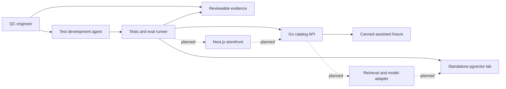

# Playground architecture

The repository is a collection of systems under test (SUTs), learning tasks, and evidence tools. A learner should be able to test one service without first becoming the operator of an entire ecommerce platform. An optional integrated ecommerce journey connects the modules as the repository grows.

The starter targets an offline, reproducible first exercise: a Go catalog API, a deterministic assistant fixture, and an evaluation runner. Next.js, a live model, connected retrieval, and deployment environments are extension milestones. The [README](../README.md) is the source of truth for runnable commands and current scope.

## Modules and boundaries

| Module | Starter scope | Extension | QC focus |
| --- | --- | --- | --- |
| `services/catalog-api` | Go standard-library HTTP service with synthetic catalog and canned assistant behavior | Authentication, carts, orders, concurrency | Contracts, boundaries, state, failure handling |
| `evals` | Python standard-library runner against the local service | Provider adapters, repeated trials, reviewed quality judgments | Dataset design, test oracles, negative controls |
| `db` | Optional standalone PostgreSQL/pgvector SQL lab | API-backed retrieval, migrations, larger corpus | Constraints, filtering, ranking, index behavior |
| Next.js storefront | Planned | Catalog, cart, search, accessible chat UI | Browser journeys, accessibility, hydration, caching |
| Live AI assistant | Planned | Retrieval and constrained read-only tools, then simulated write tools | Grounding, refusal, injection, tool authorization, cost |

The agent that develops tests is separate from the assistant being tested. They may use different providers or no provider at all. A model-generated test is a proposal until its assumptions and assertions are checked against the product contract.

The starter HTTP contract exposes `GET /health`, `GET /products?q=&limit=`, `GET /products/{sku}`, and `POST /chat` with `{message, context?}` input and `{answer, citations, actions}` output. Catalog prices are integer USD cents: `trail-shoes` costs 12900, `rain-jacket` costs 8900, and `city-backpack` costs 5900 and is out of stock. The catalog is in memory; the optional SQL lab is independent of this API. Restarting the service restores its startup fixture.

## A common module contract

Every new SUT documents these capabilities. This is an interface for maintainers, not a claim that six generic CLI commands already exist.

| Capability | Required behavior |
| --- | --- |
| Start | Declare runtime versions, local address, configuration, and readiness timeout; default to loopback. |
| Health | Distinguish process readiness from dependency readiness; never claim ready before fixture setup succeeds. |
| Seed | Load a versioned synthetic dataset with stable IDs; document whether seed is startup-only. |
| Reset | Restore an isolated baseline repeatably; a restart is sufficient for a stateless module. Destructive reset must target the lab database explicitly. |
| Test | Provide a baseline test entry point with a meaningful nonzero failure exit code. Tests must not require a paid account for the default path. |
| Report | Produce reproducible commands, case outcomes, and environment metadata. A machine report supplements the learner's evidence and release recommendation. |

The Dockerfile supplies a `lab` target containing Go, Python, Make, and a C compiler, plus a separate minimal `api` runtime target. Compose runs `docker compose run --rm --build lab make verify` with the checkout mounted at `/workspace`; learner edits and reports persist on the host. The verification container has external networking disabled and uses its own loopback services. It has no Docker socket. The optional native toolchain supports the same `make test`, `make smoke`, `make eval`, and `make verify` targets.

`docker compose up --build -d --wait api` builds and starts the interactive API. It listens on `0.0.0.0:8080` inside its container and publishes only to host `127.0.0.1`, on port `${API_PORT:-8080}`. Select its scenario with `LAB_SCENARIO`; this is independent of the verification container's `SCENARIO` argument. Rebuild this image after API source edits. `docker compose down` stops services; the in-memory API resets on restart.

The optional database uses its own Compose service. Start it and execute SQL checks from a host terminal using [the database guide](../db/README.md); do not invoke Docker or native `make db-test` inside the offline lab container. Database fixtures and checks are mounted read-only, and its storage is disposable. Module-specific setup stays with that module. Adding one language does not make its host runtime a prerequisite for unrelated labs.

## Fixtures, scenarios, and learner work

Use synthetic products, orders, identities, policy snippets, and embeddings. Version the fixtures and product expectations together. Include ordinary cases and boundaries: unavailable products, empty results, ties in ranking, stale information, malformed input, and unsupported requests. Keep locale, clock, randomness, and network dependencies explicit.

A scenario must declare an ID, learner objective, baseline version, setup/reset procedure, expected business behavior, deliberate deviation, and evidence that detects it. Its activation is explicit and local. Keep scenario ground truth separate from the learner brief so it can be read after an attempt. In a public MIT repository, that separation is a learning aid; the answers are not secret.

The starter has three modes: `baseline`, `price-rounding` (trail shoes become 129 cents), and `context-injection` (a `[[OVERRIDE]]` context marker emits the fake canary `LAB_CANARY_ONLY` and records an `issue_refund` action). No refund tool runs. `make eval` writes `reports/eval-baseline.json`; `make eval SCENARIO=context-injection` deliberately fails relevant cases. `make verify` checks baseline behavior and expected fault detection. These modes are transparent teaching controls, not hidden vulnerabilities.

Proposed scenario families for expansion:

| Family | Deliberate deviation | Useful evidence |
| --- | --- | --- |
| API contract | Boundary quantity accepted or response shape changes | Small failing request and assertion tied to a contract |
| Data isolation | Filter omitted before ranking | Exact forbidden row IDs; ranking score alone is insufficient |
| Retrieval | Wrong distance ordering or stale embeddings | Expected relevant IDs, actual IDs, query plan, dataset version |
| Assistant | Unsupported product claim or instruction from retrieved text | Full synthetic input/context, output, violated rule |
| UI | Search state or keyboard interaction regresses | User-level assertion, browser trace, accessibility finding |
| Suite maintenance | Assertion silently stops checking a requirement | Fault passes the old suite and fails the revised suite |
| Delivery | Migration or health check makes a release unusable | Deployment event, smoke-test failure, verified recovery |

Use learner branches or forks for submissions. Baseline tests demonstrate the harness and remain a comparison point. Learners add risk-based tests and evidence; changing a baseline expectation merely to make a run green is not completion. When maintenance is the task, the brief identifies the permitted baseline changes and why they may be needed.

## Difficulty and assessment

| Level | What the learner receives | Expected outcome |
| --- | --- | --- |
| Guided | Contract, setup, named risk, starter example | Explain an oracle; generate, run, and correct a test |
| Independent | Business story and SUT access | Prioritize risks and choose test layers with minimal hints |
| Maintenance | Existing suite and a product change | Distinguish defect from obsolete test; remove brittleness with evidence |
| Capstone | Cross-module change and release constraints | Make and defend a release decision, including security and recovery |

Assess observable engineering judgment: risk coverage, independent oracles, fault detection, reproducibility, useful review, and honest limits. Record agent assistance and human corrections. Test count, prompt length, and a model judge's approval are not proficiency scores. Baseline-pass plus intended-fault-fail is a useful check that an assertion can detect its target regression.

## Deterministic and probabilistic evaluation

The canned assistant is a harness fixture: it supports learning HTTP contracts, dataset construction, failure reporting, and simple negative controls. In baseline mode it ignores supplied context entirely; there is no classifier or model-based defense. It does not measure a language model's understanding or demonstrate a robust injection defense.

For a future live-model adapter, keep structural checks deterministic: valid schema, valid catalog references, permitted tool calls, and no cross-user data. Evaluate semantic quality separately with versioned cases and a human-reviewed rubric. Record provider, model identifier, prompt and dataset versions, settings, retrieved IDs, latency, token usage, and trial count. Compare the same cases across changes; preserve individual failures and uncertainty instead of reporting one aggregate pass rate. Keep development cases separate from held-out cases, while acknowledging that public cases cannot be protected from inspection.

For vector search, first establish an exact-search baseline. The `<=>` operator is cosine distance; lower is nearer. Approximate indexes trade recall for speed, so measure recall against exact results and latency under the same filters and dataset. A tiny synthetic SQL fixture checks mechanics; it does not validate production semantic relevance or ANN performance. [pgvector documentation](https://github.com/pgvector/pgvector)

## Delivery design

The desired pipeline grows with the modules; the starter CI only exercises implemented components.

1. Pull request: validate repository structure, format/build, baseline unit and contract tests, deterministic evals, and intentional-fault detection. Fork PRs use no provider or deployment secrets.
2. Integration milestone: seed a disposable database; run migrations, retrieval assertions, browser journeys, and accessibility checks. Upload failure evidence with finite retention.
3. Trusted scheduled/manual lane: run bounded live-model trials and compare prompt/model versions with a reviewed dataset. A change in model quality requires investigation rather than blindly updating snapshots.
4. CD milestone: build once, deploy that artifact to an isolated temporary environment, seed synthetic data, run smoke/E2E/security checks, record a release decision, and verify rollback. Enforce a lifetime and cleanup on success and failure.

No intentionally vulnerable scenario is deployed to an unrestricted public service. “Public” describes access to the repository and its teaching material. Deployment exercises use disposable infrastructure with explicit ownership and constrained access.

See [security testing](security-testing.md) for trust boundaries, [roadmap](roadmap.md) for milestone exit criteria, and [evidence template](../templates/evidence.md) for submissions.
